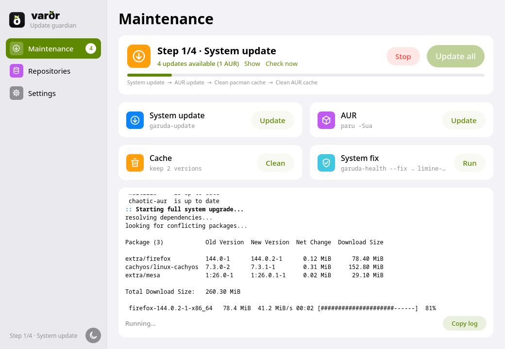
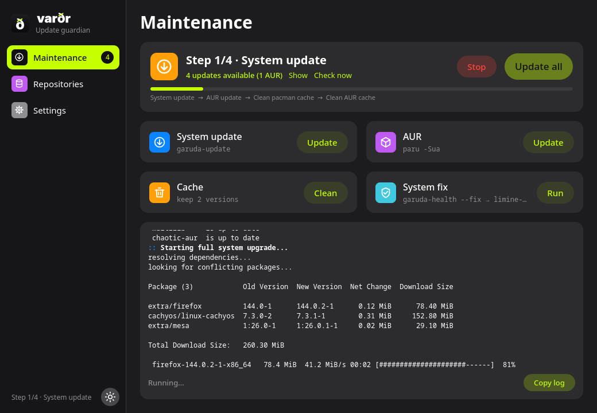

# Garuda Pilot

One-click system maintenance for Garuda Linux and other Arch-based systems. A lean replacement for the Garuda Toolbox maintenance tasks, built with PySide6/QML.

*Not affiliated with the Garuda Linux project.*



## Features

- **Update all**: system update → AUR → cache cleaning in one run, stops at the first failing step
- **Custom update command** (default `garuda-update`), optionally run as root via pkexec
- **AUR updates** with paru or yay, run as your user (`-Sua --sudo pkexec`)
- **Cache cleaning** with `paccache`: keep the last 1–3 versions, drop uninstalled packages; pacman cache and AUR build directories
- **Fix command** (default `garuda-health --fix`, followed by `limine-update` if installed)
- **Repository editor** for `/etc/pacman.conf`: enable/disable, reorder by drag, SigLevel, add with key import, remove, raw text mode; validated with `pacman-conf`, timestamped backup, followed by a full update (no partial `-Sy`)
- **Mirror ranking** with `rate-mirrors` for Arch, chaotic-aur and CachyOS (v3/v4 lists derived)
- **Update check** in the background (`checkupdates` + AUR), interval off/1/6/12/24 h, tray icon, notification only for new updates
- Live terminal output with in-place progress bars and Yes/No buttons for prompts
- Light/dark mode following the desktop, with manual override



## Requirements

`python`, `pyside6`, `pacman-contrib`, `polkit` (plus a running polkit agent).
Optional: `paru` or `yay`, `rate-mirrors`, `garuda-update`.

## Install

```sh
git clone https://github.com/fromaaage/garuda-pilot.git
cd garuda-pilot/packaging
makepkg -si
```

Or run from source: `python app.py` (`--tray` starts hidden in the tray).

## Notes

- Root steps use pkexec (one password prompt per step; AUR helpers may ask again while installing).
- With the tray available, closing the window keeps the app running. "Start at login" writes `~/.config/autostart/garuda-pilot.desktop`.
- Settings: `~/.config/garuda-pilot/settings.json`.
- Backups: `/etc/pacman.conf.bak-<timestamp>`, mirror lists as `<file>.garuda-pilot.bak`.

## License

MIT
